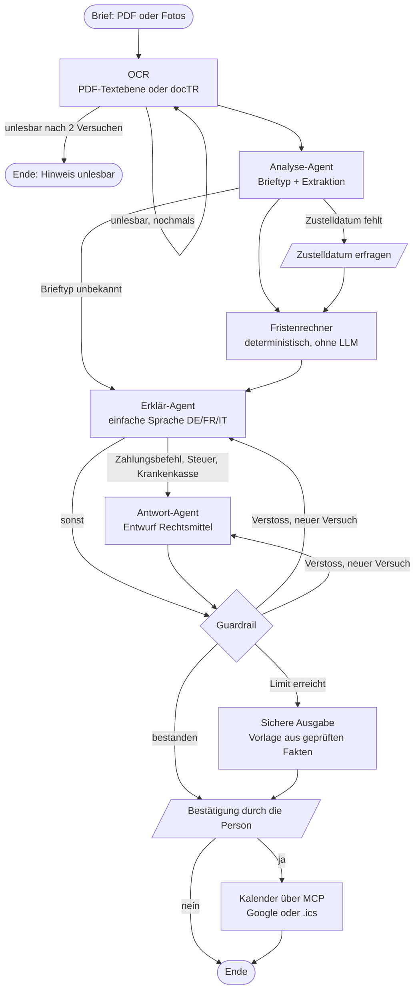

# qq_govdox – Behördenbrief-Erklärer

Gruppenarbeit im Modul Generative KI (FHNW, HS 2026). Ein LLM-Agent auf Basis von LangGraph:
Man fotografiert einen Schweizer Behördenbrief (Zahlungsbefehl, Steuerveranlagung,
Krankenkassen-Prämie, Mahnung), der Agent erklärt ihn in einfacher Sprache (DE/FR/IT),
berechnet Fristen deterministisch, entwirft eine Antwort und trägt die Fristen nach
Bestätigung in den Kalender ein.

## Ablauf



Parallelogramme sind Human-in-the-loop-Schritte (`interrupt()`). Die LLM-Nodes haben eine
Retry-Policy für Verbindungs- und Formatfehler (`llm.py`).

## Aufbau

| Pfad | Inhalt |
|---|---|
| `graph.py` | LangGraph-Graph: Nodes, Kanten, Routing |
| `nodes/` | Ein Modul pro Node (OCR, Analyse, Fristen, Erklärung, Antwort, Guardrail, sichere Ausgabe, Bestätigung, Kalender, Zustelldatum) |
| `state.py` | State-Schema des Graphen (Vertrag zwischen den Nodes). Owner: Vendon, Änderungen per Pull Request |
| `prompts.py` | System-Prompts aller LLM-Agenten |
| `llm.py` | LLM-Anbindung (LiteLLM-Proxy der FHNW oder Apertus), Retry |
| `fristenrechner.py`, `datum.py` | Fristen nach SchKG/ZPO und Datums-Parsing, deterministisch in Python |
| `mocks.py` | Handgeschriebene Mock-States und `aus_gold()` zum Laden der Testbriefe |
| `main.py` | Testbriefe durch den Graphen schicken und mit `gold.json` vergleichen (Evaluation) |
| `laeufe.ps1` | Evaluationsläufe: 3× Haiku, 1× Apertus über alle 45 Briefe |
| `app.py` | Web-Oberfläche (Streamlit), siehe «Oberfläche» unten |
| `studio.py`, `langgraph.json` | Einstieg für LangGraph Studio |
| `mcp_kalender/` | Kalender-MCP-Server: trägt bestätigte Fristen in den Google Kalender ein (siehe unten) |
| `daten/briefe/` | 45 synthetische Testbriefe mit PDF, Scan, Handyfoto, Textebene und Gold-Label |
| `daten/laeufe/` | Protokolle und Auswertungen aller Evaluationsläufe (siehe dortiges README) |
| `datengenerator/` | Skripte, mit denen die Testbriefe erzeugt werden (siehe dortiges README) |
| `tests/` | Tests ohne LLM (`teste_*.py`) und gespeicherte Guardrail-Fälle |
| `skripte/` | Hilfsskripte: OCR-Auswertung, Guardrail-Fälle speichern, Apertus-Verbindungstest |
| `notebooks/00_state_und_mocks.ipynb` | Aus der Aufbauphase: State-Vertrag, Mocks, Datensatz, Graph-Skelett mit Dummy-Nodes (läuft ohne API-Key) |

## Ergebnisse

Evaluation über alle 45 Testbriefe als Handyfoto (Stand 16.11.2026, Details in
[`daten/laeufe/2026-11-16_auswertung.md`](daten/laeufe/2026-11-16_auswertung.md)).
Geprüft werden Brieftyp, Fristen, Betrag und Injection-Erkennung gegen `gold.json`.

| Modell | korrekt | korrekt und vom Guardrail freigegeben | Dauer |
|---|---|---|---|
| Claude Haiku 5.5 (3 Läufe) | 42 / 42 / 41 | 41 / 42 / 40 | ~19 min |
| Apertus v1.5 70B (1 Lauf) | 20 | 16 | 48 min |

Entwicklung mit Haiku: 29/45 (erster Foto-Lauf, 04.11.) → 34–38 (Graph mit Guardrail, 06.–09.11.) → 41–42 (16.11.).
Bekannte Grenzen:

- Prompts und Guardrail wurden mit Haiku an diesen 45 Briefen entwickelt; für neue Briefe ist
  die Quote eher optimistisch, und der Apertus-Vergleich misst auch, wie gut ein Modell ohne
  Anpassung in die Pipeline passt.
- Der Guardrail prüft, ob Erklärung und Antwort zu den extrahierten Fakten passen, nicht ob die
  Fakten selbst stimmen. Ein Fehler in der Analyse geht deshalb durch (z. B. Konkursandrohung
  als Zahlungsbefehl erkannt).
- Systematische Fehler mit Haiku: Brief 04 (handschriftliches Datum im Foto), 13 (falsche
  Betragszeile bei Rückerstattung), 14 (Injection nicht erkannt).

## Loslegen

Entwickelt mit Python 3.14 (Windows), Tests auch unter Linux mit Python 3.13. `requirements.txt` enthält docTR mit PyTorch für die Texterkennung
von Fotos (gross, erste Installation dauert einige Minuten).

```bash
python -m venv .venv
.venv\Scripts\activate          # Windows; unter Linux/macOS: source .venv/bin/activate
pip install -r requirements.txt
```

**Ohne API-Key** laufen die Tests (siehe «Evaluation und Tests») und das Notebook
`notebooks/00_state_und_mocks.ipynb` (State-Vertrag, Datensatz, Graph-Skelett mit Dummy-Nodes).
Die Protokolle aller Evaluationsläufe liegen in `daten/laeufe/`.

**Mit API-Key** läuft der ganze Agent: `.env.example` nach `.env` kopieren und einen OpenAI-kompatiblen
Endpunkt eintragen (wir nutzen den LiteLLM-Proxy der FHNW mit Claude Haiku, alternativ Apertus
über die Swiss AI Plattform). Dann:

```bash
python llm.py                      # Verbindung testen, verfügbare Modelle anzeigen
streamlit run app.py               # Oberfläche: Testbrief wählen oder eigenen Brief hochladen
python main.py 03                  # ein Testbrief in der Konsole, mit Vergleich gegen gold.json
```

Einzelne Nodes lassen sich mit einem passenden State aufrufen:

```python
from mocks import mock_bis, aus_gold
state = mock_bis("zahlungsbefehl", "fristen")                 # handgeschriebener Mock
state = aus_gold("01_zahlungsbefehl_de_wochenende", "foto")   # Fall aus dem Datensatz
```

## Oberfläche

```bash
streamlit run app.py
```

Öffnet sich im Browser (http://localhost:8501). Brief hochladen (PDF oder Fotos, eine Datei
pro Seite) oder einen der 45 Testbriefe wählen. Die UI stellt die Fragen des Graphen
(Zustelldatum, Bestätigung) als Eingabefelder und bietet die Fristen als `.ics`-Datei an.
Fristen stehen oben in einem eigenen Kasten, weil sie aus dem Fristenrechner kommen, nicht vom LLM.
Schrift im Kopf: «Some Time Later» von Fredrick R. Brennan (SIL Open Font License,
`static/some-time-later-LICENSE.txt`), Quelle https://github.com/ctrlcctrlv/some-time-later.

## Evaluation und Tests

```bash
python main.py 01                    # ein Brief (Anfang der Fall-ID genügt)
python main.py _ --variante foto     # alle 45 Briefe als Handyfoto (auch: pdf, scan)
powershell -ExecutionPolicy Bypass -File .\laeufe.ps1   # 3× Haiku + 1× Apertus, Ausgabe in daten/laeufe/
```

`main.py` braucht eine `.env` (Vorlage `.env.example`). Die Tests laufen ohne LLM:

```bash
python tests/teste_fristenrechner.py   # Fristen gegen gold.json und Rechtsfälle
python tests/teste_guardrail.py        # 24 Negativfälle und 45 gespeicherte Positivfälle
python tests/teste_analyse.py
python tests/teste_erklaerung.py
python tests/teste_sichere_ausgabe.py
python tests/teste_retry.py
python tests/teste_app.py
```

`tests/teste_ferien_live.py` ruft das LLM auf (Zahlungsbefehl in den Betreibungsferien).

## Zuständigkeiten

| Person | GitHub | Agent | Weitere Bausteine |
|---|---|---|---|
| Melvin | `GingFreecssQQ` | Antwort-Agent | LangGraph-Graph, Routing, Human-in-the-loop |
| Nayan | `Tayo0o0` | Analyse-Agent | Texterkennung/OCR (docTR), Kalender-MCP |
| Vendon | `Vendoni` | Erklär-Agent | Fristenrechner, State |
| Florian | `darqql0rd` | Guardrail-Agent | Evaluation, Apertus-Vergleich, UI |

Commits von `Claude` bzw. mit «Co-Authored-By: Claude» sind mit Claude (Anthropic) als
Programmierassistent entstanden; die fachlichen Entscheide und die Evaluation liegen beim Team.

## Graph in LangGraph Studio (LangSmith)

```bash
langgraph dev --tunnel --no-reload --allow-blocking
```

Startet einen lokalen Server mit einer öffentlichen https-Adresse (`…trycloudflare.com`, bei
jedem Start neu). `--no-reload` ist nötig, sonst lädt der Server wegen eigener Dateien
(`.langgraph_api/`) ständig neu. `--allow-blocking` ist nötig für den Google-Kalender:
Der Kalender-Node startet den MCP-Server als Unterprozess, was der Dev-Server sonst als
«BlockingError» abbricht (in UI und `main.py` kein Problem). Ohne Tunnel blockieren Firefox, Brave und Safari den Zugriff
auf localhost meist.

Verbinden (getestet mit Firefox, Tracking-Schutz für smith.langchain.com aus):

1. Warten, bis im Terminal «Server started» steht.
2. https://eu.smith.langchain.com/studio/ öffnen → «Connect to a local server».
3. Base-URL = Tunnel-Adresse aus dem Terminal, **ohne `/` am Ende**
   (sonst ruft Studio `//assistants/search` auf → 404).
4. «Advanced Settings» → dieselbe Adresse bei den erlaubten Domains/Origins hinzufügen → Connect.

In Studio sieht man den Graphen, kann einen Brief starten, z. B.
`{"dokument_pfade": ["daten/briefe/03_zahlungsbefehl_de_vertreter_ohne_zustelldatum/brief.pdf"], "nutzersprache": "de"}`,
die Fragen beantworten (`18.11.2026`, `ja`) und den State nach jedem Node ansehen.
Konfiguration: `langgraph.json`, Einstieg `studio.py` (ohne eigenen Checkpointer, den stellt der Server).

## Warum Claude Haiku

- Die heiklen Teile sind deterministisch in Python: Fristen (Fristenrechner), Prüfung (Guardrail),
  Fallback (sichere Ausgabe), Vorzeichen und Datumsformate. Das LLM klassifiziert, extrahiert in ein
  festes Schema und formuliert. Dafür reicht ein kleines, schnelles Modell.
- Zuverlässige strukturierte Ausgabe (`with_structured_output`) und gute Texte in DE/FR/IT.
- Schnell und günstig: 3–6 LLM-Aufrufe pro Brief, 45 Briefe mehrfach evaluiert (~19 min pro Lauf).
- Über den LiteLLM-Proxy der FHNW verfügbar; Haiku akzeptiert nur die Standard-Temperatur, deshalb
  die Spanne über drei Läufe.
- Apertus (offenes Schweizer Modell) haben wir im gleichen Graphen verglichen (siehe «Ergebnisse»):
  interessant für echte Briefe mit Personendaten, in dieser auf Haiku abgestimmten Pipeline aber
  deutlich schwächer (20/45).

## Warum kein RAG

Ursprünglich geplant war RAG über offizielle Infoblätter. Wir haben bewusst darauf verzichtet:

- Das nötige Wissen ist klein und stabil (vier Brieftypen, ihre Rechtsmittel und Fristen) und
  steht direkt im Prompt.
- Fristen berechnet der Fristenrechner deterministisch in Python, nicht das LLM.
- Der Guardrail prüft jede Aussage gegen die Fakten im State (Extraktion, Fristen). Texte aus
  einem Retrieval liessen sich so nicht prüfen und wären eine zusätzliche Fehlerquelle.

## Kalender (Google Kalender über MCP)

Der Kalender-Node (`nodes/kalender.py`) startet den MCP-Server `mcp_kalender/server.py`
selbst und ruft dessen Tool `frist_eintragen` auf. Standard ist `KALENDER_KANAL=ics` in
`.env`: Dann entsteht nur eine `.ics`-Datei in `ausgabe/`, der echte Kalender bleibt leer.
Dasselbe passiert, wenn Google nicht erreichbar oder das Login abgelaufen ist.

Google einrichten (einmalig):

1. In der Google Cloud Console die Google Calendar API aktivieren und einen OAuth-Client
   vom Typ „Desktop-App“ erstellen, das JSON als `credentials.json` in den Repo-Ordner legen.
   Das eigene Google-Konto als Testnutzer eintragen.
2. In `.env`: `KALENDER_KANAL=google` und `GOOGLE_CALENDAR_ID=<Kalender-ID>`.
3. `python mcp_kalender/login.py` – Browser-Login, danach liegt `token.json` im Repo-Ordner.
   Im Google-Status „Testing“ läuft das Login nach 7 Tagen ab, dann nochmals ausführen.

`credentials.json` und `token.json` stehen in `.gitignore` und gehören nie ins Repo.
Tools von Hand testen: `mcp dev mcp_kalender/server.py` (MCP Inspector).

## Datenschutz

Alle Briefe sind synthetisch; Personen, Ämter, Adressen und IBANs sind erfunden.
Keine echten Briefe ins Repo, Zugangsdaten nur in `.env`.
